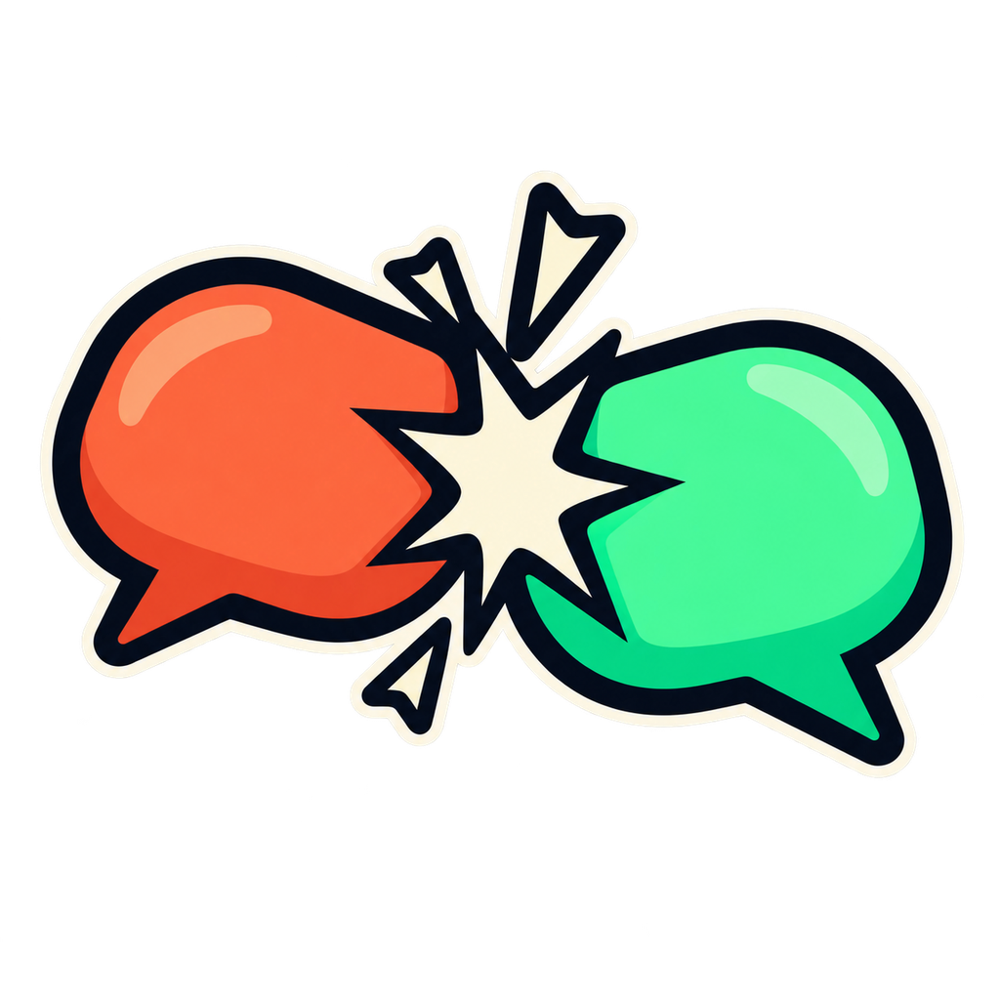

# Chat Clash

**The most active community wins.** Chat Clash turns two Twitch communities into
teams in a three-minute live battle. Messages, new participants, emote combos and
a flash challenge move a shared scoreboard, then RUSH ×2 opens the door to a
comeback. The winning chat votes on a safe, voluntary penalty approved by both
streamers. A transparent OBS overlay makes the action easy to follow. Built with
Codex for the Codex × TwitchCon Hackathon; no AI calls or paid AI services run
during a match.

## Try it without Twitch — 60-second quick start

Use **Node.js 22** and npm in your checkout. No credentials or `.env` are needed.

```sh
npm ci
npm start
```

1. Open [the control panel](http://127.0.0.1:3000/control/).
2. Choose **12×** under simulator speed, then click **Start simulator**. Watch a
   complete round, including voting, in about **17.5 seconds**.
3. In OBS, add a **Browser Source** with URL
   **http://127.0.0.1:3000/overlay/**, width **1920**, height **1080**. The overlay
   has a transparent background; the control preview's checkerboard is just a
   transparency guide. You can also [open the overlay](http://127.0.0.1:3000/overlay/)
   directly without OBS.

Simulator speed advances the virtual clock; scoring rules stay the same. Use
**Stop** to abort, **Reset** to clear, or start another round after completion.
Refreshing reconnects to the same in-memory match. The simulator sends no Twitch
messages and uses demo penalty approvals. See [fresh-clone verification](docs/fresh-clone.md).

## Connect real Twitch channels

Follow [the two-account setup and test guide](docs/twitch-test.md). Copy
`.env.example` to `.env` only if you do not already have one, fill in your public
Client ID and channel logins, then authorize the accounts in the local controls.
Wait for **BOTH CHATS READY**, approve the safe penalties as both streamers, and
click **Start round**. Real rounds always run at normal speed. Two offline chat
rooms work; a live broadcast is optional for testing.

The app uses public-client **Device Code OAuth**: no client secret or redirect
URI. Non-Affiliate channels support chat and raids; Bits and channel points are
optional. `.env` and `.local/` stay ignored. Tokens and reward mappings persist
locally with owner-only permissions; matches clear on restart.

## Scripts and checks

```sh
npm run dev           # server with TypeScript watch mode
npm start             # same server, without watch mode
npm test              # Node test runner, explicit fake-clock timestamps
npm run typecheck     # strict TypeScript, no output files
npm run sim           # full seeded round instantly in the terminal, no server
npm run sim -- 123    # choose another deterministic simulation seed
```

`npm run sim` has its own virtual clock and does not feed a separately running
server. Use **Start simulator** in the control panel to animate the OBS overlay.

## Round timeline

| Elapsed | Phase | Behavior |
| --- | --- | --- |
| 0:00–1:30 | Battle | Normal scoring |
| 1:30–2:00 | Flash challenge | Chat scoring continues; challenge worth +25 |
| 2:00–2:30 | Battle | Normal scoring resumes |
| 2:30–3:00 | RUSH ×2 | All newly awarded base points are doubled |
| 3:00–3:30 | Verdict + vote | Scores freeze; only winning-team votes count |
| 3:30 | Complete | Selected penalty shown; never automatically executed |

## Scoring and edge cases

All scoring values, caps, thresholds and durations live in **`data/config.json`**.
Restart the server after changing the config or challenge library.

| Event | Base points | Limit |
| --- | --- | --- |
| Chat message | +1 | Once per user, per team, every 5 seconds |
| First participation | +3 | Once per user, per team, per round |
| Emote combo | +10 | 5 distinct users sending the same emote within 10 seconds |
| Reinforcement redemption | +5 | 3 redemptions per user per round |
| Bits | +1 per 100 | 10 base points per user per round |
| Incoming raid | +1 per 10 raiders | 50 base points per raid |
| Flash challenge | +25 | One team, once, at the end of the window |
| Final rush | ×2 | Applied after caps; final 30 seconds only |

- First participation includes a user's first valid chat, Reinforcement redemption
  or cheer. A raid scores for the team and does not create a participant.
- Per-user counters are scoped to each team. A viewer can participate in both
  communities independently.
- Partial hundreds of bits accumulate per user across the round. Caps count base
  points, so earning the remaining allowed points during rush doubles those awards.
- Cooldowns and combo windows include their exact 5-second and 10-second edges.
  A qualifying combo consumes its participant set; a fresh set can qualify again.
  Combo credit is shared evenly between its contributors for MVP ranking.
- Emotes are matched using normalized emote metadata, not words that merely look
  like emote names. Ordinary messages can contain several distinct emotes.
- MVPs rank the top three per team by awarded user points, then earliest first
  participation, then user ID. Raid and challenge bonuses are team points.
- Timestamps must be monotonic; stale events are ignored. The Twitch adapter must
  deduplicate provider deliveries before emitting normalized events.
- A tied match has no penalty vote. Each winning-chat user gets one valid vote:
  `!vote 1`, `!vote 2`, etc. Invalid votes do not consume that opportunity. A tied
  penalty vote picks the earliest option in the approved list; no votes means no
  penalty. All scoring and voting windows are exclusive at their end boundary.

## Flash challenges

`data/challenges.json` contains **160 original bilingual records**, each with an
English and Italian prompt: 40 trivia, 30 anagrams, 30 quick math, 30 type-races and
30 emote targets. Every record has a unique ID and deterministic judging metadata.

- **Trivia, anagram, math:** most distinct correct users within the 30-second
  window wins. A tie goes to the team whose correct answer arrived first.
- **Type-race:** the first correct answer wins.
- **Emote target:** the first team to reach 10 distinct users sending the target
  emote inside a rolling 10-second window wins. Fewer than 10 does not qualify.
- When timestamps are identical, normalized-event processing order determines the
  first correct answer or finisher. No qualifying answers means no bonus.
- Text judging ignores case, accents and whitespace. Punctuation is significant.
  A localized race prompt displays the localized phrase; either listed language
  is accepted. Anagram prompts specify the language of the scrambled word.
- The selected challenge stays private until 1:30. Accepted answer arrays and raw
  chat messages are never included in HTTP or WebSocket snapshots.

The simulator uses synthetic emote names and produces correct answers, wrong
answers, spam, coordinated bursts, paid events, an incoming raid, uneven activity
and post-round votes. `scripts/build-challenges.py` rebuilds the checked-in library
from authored content using Python's standard library; Python is not a runtime
dependency. Live rounds post flash prompts, results, rush, verdict and penalty-vote
instructions using the configured bot's user token. Simulator rounds never post to
Twitch. Choose a specific next challenge type in the controls for testing. Live
emote targets resolve to actual global Twitch emote IDs and names.

## Penalties

The control panel edits the approved list by selecting from the safe, voluntary
catalog in `data/penalties.json`. Both streamers must approve the current list
before **Start round** succeeds. Editing names or the list clears the UI approvals;
settings and penalties are frozen while a round or vote is active.

**Start simulator** explicitly uses demo approvals and sends nothing to Twitch.
These simulated approvals never become the approvals for a real round. Custom
unreviewed penalties are rejected by the server. Edit the source catalog to add
new safe options for both streamers to review.

## Architecture

```text
data/
  config.json          # scoring, caps and phase timing
  challenges.json      # 160 bilingual challenges
  penalties.json       # safe, voluntary penalty catalog
src/
  game/                # pure reducer, challenge normalization/selection, snapshots
  sim/                 # seeded normalized-event producer and terminal demo
  twitch/              # device OAuth, private tokens, EventSub, dedup and chat queue
  server.ts            # Node HTTP, read-only WebSocket fanout, clock and controls
public/
  overlay/             # transparent 1920×1080 OBS scoreboard
  control/             # responsive streamer control panel and live preview
  shared/              # reconnecting WebSocket client
  brand/               # generated 1024px transparent mark and favicon exports
test/                  # scoring, fake-clock game tests, data and server integration
docs/codex-log.md       # implementation and verification record
AGENTS.md              # project brief and contributor conventions
```

No frontend build, external fonts, CDN or AI SDK is used. Twitch is the only
external runtime service. One process owns one match. `src/game/` takes events and explicit timestamps and returns
new state; it does not read files, call clocks, start timers or access the network.
The server owns I/O, randomness for challenge selection, bounded logs and 4 Hz
snapshots. Shared clients reconnect with backoff and mark stale connections.

Local endpoints: `GET /health`, `GET /api/state`, `POST /api/control`, and the
read-only WebSocket `/ws`. Same-origin checks and loopback binding are enforced.
Controls accept `configure`, `start`, `start-simulator`, `stop`, and `reset`.
Twitch controls use `POST /api/twitch`; activation codes are fetched directly by
the controls from `GET /api/twitch/device` and are never broadcast to OBS clients.
Live rounds stop on lost chat connections; planned reconnects preserve subscriptions.
Normalizing, deduplicating, bot-echo filtering and native emote/reward ID checks
happen before an event reaches the pure game engine.

## Brand

`public/brand/logo.png` is the **1024×1024 transparent PNG** generated for this
project; PNG and multiresolution ICO favicons are included. The mark shows two
colliding speech bubbles with a spark, without third-party logos or characters.
The generation prompt and export provenance are in `public/brand/README.md`.

## How Codex built this

Codex scaffolded the Node 22 / strict TypeScript app, implemented the pure reducer
and seeded simulator, and built the local server, overlay and controls. It added
160 original bilingual challenges, mocked Device Code OAuth and EventSub tests,
and privacy checks for public snapshots. Tests caught a misleading privacy fixture;
explicit timestamp regressions fixed same-millisecond challenge ties. Browser
review caught a preview scaling bug and an opaque overlay fallback. Human testing
then verified two real chat connections, scoring, rush, a flash result and voting.
The [build log](docs/codex-log.md) records the work, verification and remaining gaps.

## Known limitations

- **Local-only, with no authentication.** Run on loopback; do not expose or deploy
  the controls publicly.
- **One match per process**, held in memory. Restarting clears match state.
- Combos, emote targets, Bits, channel points and raids are verified only by mocked
  tests and the simulator, **not by a live multi-user test**. Two-account manual
  tests covered basic chat scoring, cooldowns, rush, a type-race result and a valid
  penalty vote. A later round's votes arrived after the deadline.
- A lost chat connection stops a live round; missed events are not replayed.
- Penalties are display-only and voluntary. Both streamers must approve the list
  before a real round; the app never performs a penalty automatically.

## License

[MIT](LICENSE) — Copyright (c) 2026 Matteo Colucci.

The collision-bubble logo was generated for this project; all 160 bilingual
challenge records and all eight penalty options are original project content.
The shipped mark, challenge text and penalty catalog contain no third-party
logos, characters or branded challenges. See [asset provenance](public/brand/README.md)
and the authored source in `scripts/build-challenges.py`. Service names in the
documentation identify integrations; live global emotes come from Twitch and are
not shipped as original project art. Dependencies retain their own licenses.
